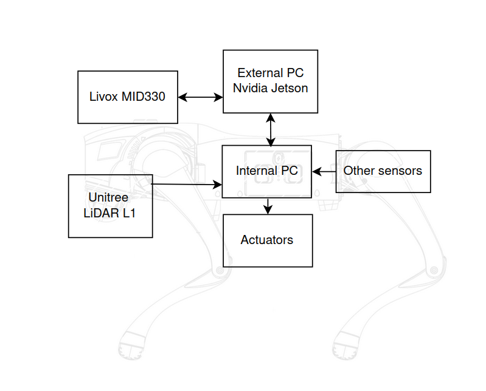
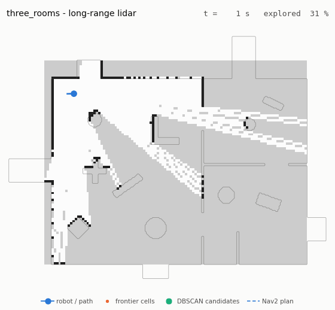
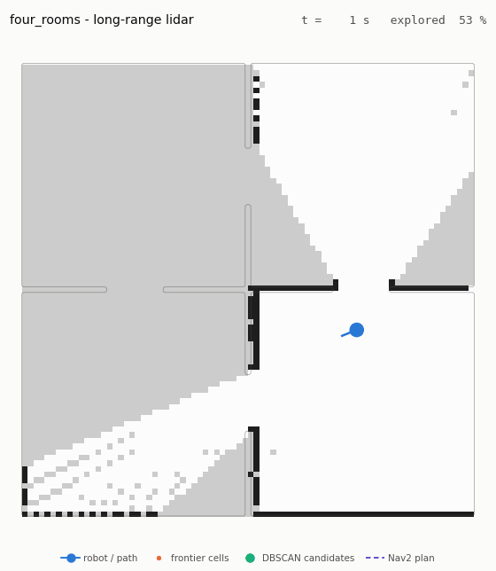
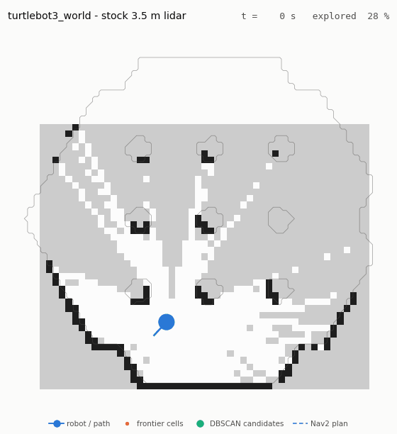
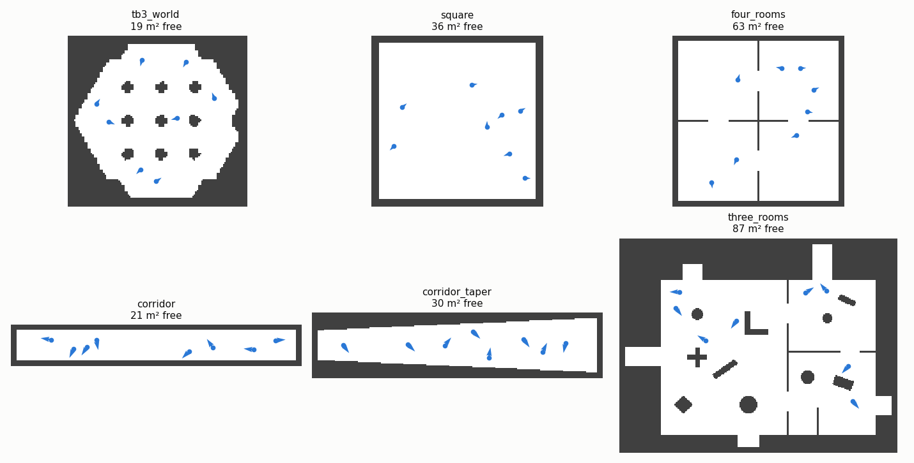
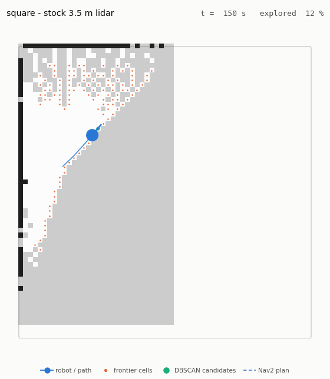
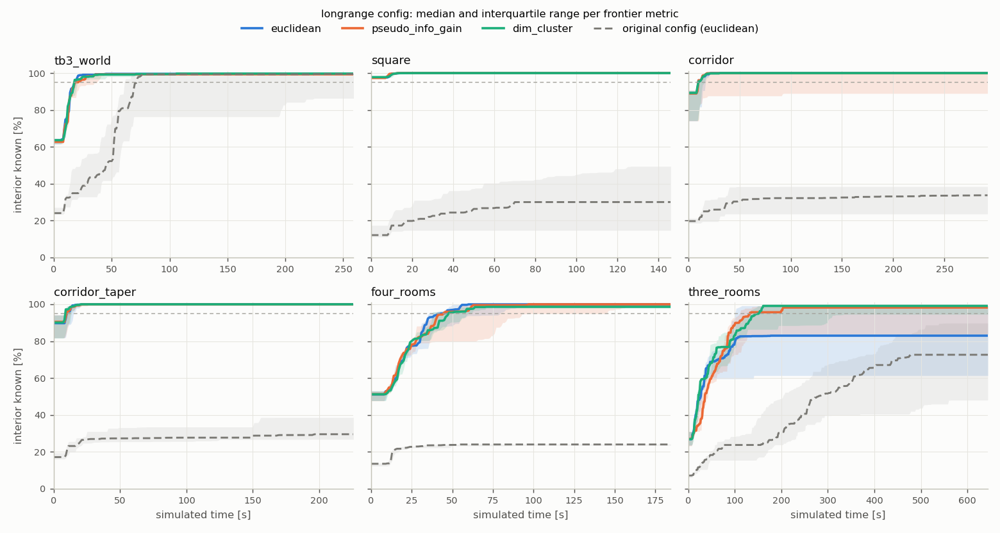

# Frontier-Based SLAM System for a Quadruped Robot

### Bachelor's Thesis Project — Scuola Superiore Sant’Anna  
**Supervisors:** Prof. C.A. Avizzano, Prof. M. Cococcioni  
**Research conducted at:** PERCRO Laboratory, Scuola Superiore Sant’Anna

---

## Project Overview

This project presents the development of a **frontier-based SLAM and autonomous exploration system** for a **Unitree Go2 EDU quadruped robot** ([Unitree Go2 EDU Documentation](https://support.unitree.com/home/en/developer/about_Go2)).  
The work integrates **SLAM, navigation, and exploration** into a single ROS2-based pipeline deployed on an **NVIDIA Jetson platform** running **Ubuntu 20.04** with **ROS2 Foxy**.

The system enables the robot to **map, localize, navigate, and autonomously explore unknown environments** using LiDAR perception and frontier-based decision-making.

---

## System Architecture

### Hardware Architecture
- **Robot:** Unitree Go2 EDU  
- **Onboard computer:** NVIDIA Jetson (Ubuntu 20.04, ROS2 Foxy)  
- **Sensor:** Livox Mid-360 LiDAR  

### Software Architecture
- **SLAM Module:** Precompiled adaptation of [LIO-SAM](https://github.com/TixiaoShan/LIO-SAM) for Livox Mid-360 and Jetson  
- **Navigation Stack:** Configured [Nav2](https://navigation.ros.org/) system  
- **Exploration:** Two custom Python ROS2 nodes implementing frontier-based exploration logic  
- **Map Projection:** Custom C++ node converting 3D LiDAR map to a 2D occupancy grid  
- **Communication Framework:** ROS2 Foxy middleware  
- **Operating System:** Ubuntu 20.04 (JetPack SDK for Jetson)




---

## 🧪 General Setup Instructions

The following setup procedure is the same **for both simulation and real-robot testing**.

### 1. Clone the repository

```bash
git clone <repo_url>
cd exploration_go2
```

### 2. Build the Docker image

```bash
docker build -t exploration_go2 .
```

### 3. Run the Docker container

```bash
./run.sh
```

### 4. Update configuration inside the container

Once inside the running container:

```bash
bash share/update_conf.sh
```

### 5. Build the ROS2 workspace

```bash
cd ros2_ws
colcon build
source install/setup.bash
```

After completing these steps, you can proceed either with **simulation testing** or **real robot deployment**.

---

## Simulation Testing (Gazebo Environment)

In simulation, **Gazebo** was used with a **TurtleBot3 model equipped with a 2D LaserScan sensor**.
This configuration was chosen for its **simplicity, repeatability, and ease of setup**, allowing numerous controlled experiments.
A virtual model of the quadruped was not used, as it would require proprietary motion control firmware or adaptation of open-source models not fully compatible with the Unitree robot.
Such an effort would have introduced additional complexity without significant benefits for evaluating the exploration algorithm.

The goal of simulation was to study the **behavior of the frontier-based exploration strategy**, which can be analyzed largely independently of the robot’s locomotion system.
Both TurtleBot3 and the quadruped share a **planar navigation model**, moving in a 2D space controlled by **linear and angular velocity commands (Twist)**.
Kinematic differences, such as limited omnidirectional capability of the quadruped, were neglected as they have minimal impact on the evaluation of exploration algorithms.

---

### Launch Instructions

Inside the Docker container, after building the workspace:

#### 1. Start Gazebo simulation

```bash
ros2 launch turtlebot3_gazebo turtlebot3_world.launch.py
```

#### 2. Launch SLAM

```bash
ros2 launch slam_toolbox online_async_launch.py use_sim_time:=true
```

#### 3. Launch Navigation (Nav2)

```bash
ros2 launch nav2_bringup bringup_launch.py use_sim_time:=true
```

#### 4. Start RViz visualization

```bash
rviz2 -d ros2_ws/map.rviz
```

#### 5. Launch the exploration node

```bash
ros2 launch explorer_pkg explorer.launch.py
```

Once all components are running, the TurtleBot3 will autonomously explore the simulated environment, mapping it through SLAM and using Nav2 for motion planning.

---

## Simulation on ROS2 Humble (reproduction)

The simulation pipeline has been reproduced on **ROS2 Humble / Ubuntu 22.04** (ROS2 Foxy is end-of-life) with Gazebo classic, TurtleBot3 burger, slam_toolbox, Nav2 and the unmodified `frontier_scanner` + `goal_manager` nodes of `explorer_pkg`. Everything needed is under [`sim/`](sim), plus the Humble Nav2 parameters [`share/nav2_params_humble.yaml`](share/nav2_params_humble.yaml) and [`Dockerfile.humble`](Dockerfile.humble).

<p align="center">
  
</p>

<p align="center">
  
  
</p>

Grey: unknown, white: free, black: occupied (slam_toolbox map). The thin outline is the ground-truth world. Orange dots are the frontier cells published by `frontier_scanner`, green dots the DBSCAN cluster candidates, the dashed violet line the current Nav2 plan. "explored" is the fraction of the world interior that is known in the SLAM map.

### Test worlds

Besides the stock `turtlebot3_world`, five worlds are generated by [`sim/worlds/gen_worlds.py`](sim/worlds/gen_worlds.py): an empty 6 × 6 m square, a 14 m straight corridor, a 14 m corridor whose walls diverge by 5° (1.5 m wide at one end, 2.7 m at the other), four rooms connected by doors, and a three-room layout (~87 m² of free space) with obstacles of different shapes, wall recesses and short dead ends. Every world is fully traversable for the robot. The start poses (arrows) are sampled uniformly at random in the free space reachable by the robot ([`sim/scripts/sample_starts.py`](sim/scripts/sample_starts.py)) and stored in [`sim/starts/`](sim/starts).



### Configurations

| | `original` | `longrange` |
|---|---|---|
| lidar (Gazebo model) | stock TurtleBot3 burger, 3.5 m | [`turtlebot3_burger_lr`](sim/models/turtlebot3_burger_lr/model.sdf), 12 m |
| slam_toolbox | [`mapper_params_online_async.yaml`](share/mapper_params_online_async.yaml) | [`mapper_params_long_range.yaml`](share/mapper_params_long_range.yaml): `max_laser_range: 11.5`, `min_pass_through: 0` |
| Nav2 | [`nav2_params_humble.yaml`](share/nav2_params_humble.yaml) | same |
| explorer_pkg | `explorator_params.yaml`, `reduction: dbscan` | same |

With the stock 3.5 m lidar, beams that hit nothing return `inf` and slam_toolbox (Karto) discards them, so free space is only cleared where a wall closer than 3.5 m is hit. In open areas the known region grows as a ragged fan whose border is made of thin, diagonal, fragmented frontier lines (square example below). DBSCAN (`dbscan_eps: 3.1` cells, `dbscan_min_pts: 7`) labels most of these cells as noise. Either no candidate survives and `goal_manager` stops sending goals, or the only surviving candidate is a frontier cell right next to the robot (`medoids_choice: nearest`): Nav2 reports the goal as reached immediately, the map does not change and the same goal is sent again (up to ~50 times per run). `turtlebot3_world` is small enough that walls are almost always within range, which is why the original setup works there. The `longrange` configuration gives the simulated lidar a 12 m range (the Livox Mid-360 used on the robot reaches even further) and lets slam_toolbox mark a cell free after a single ray pass.

<p align="center">
  
</p>

No exploration code was changed: frontier extraction, DBSCAN, the frontier metrics and the goal manager are used as they are. The metric (`euclidean`, `pseudo_info_gain`, `dim_cluster`) is passed as a parameter override.

### Quick start

```bash
docker build -f Dockerfile.humble -t exploration_go2:humble .
docker run -it --rm -v $PWD:/root/exploration_go2 exploration_go2:humble
cd ros2_ws && colcon build && source install/setup.bash && cd ..
sim/scripts/run_exploration.sh --world three_rooms --pose -4.5,3.3,0.0 --metric dim_cluster --out /tmp/run
```

Add `--gui` to open the Gazebo client (requires a display) and run `rviz2 -d ros2_ws/map.rviz` in another shell to watch the map, the frontiers and the Nav2 plan. Each run writes the logs of every component, `metrics.csv` (coverage vs simulated time) and `final_map.npz` to `--out`.

### Reproducing the results

```bash
python3 sim/scripts/make_jobs.py --configs longrange > /tmp/jobs.csv
python3 sim/scripts/make_jobs.py --configs original --metrics euclidean >> /tmp/jobs.csv
FRAMES=1 sim/scripts/run_batch.sh /tmp/jobs.csv /tmp/campaign 3
python3 sim/scripts/analyze.py /tmp/campaign --csv sim/results/summary.csv --plot repo_img/sim/coverage.png
python3 sim/scripts/make_gif.py /tmp/campaign/longrange_three_rooms_eu_0 repo_img/sim/three_rooms.gif \
    --title "three_rooms - long-range lidar"
```

`run_batch.sh` runs N simulations in parallel (each isolated with its own `ROS_DOMAIN_ID` and Gazebo port) in real time. With 3 workers on 4 cores the real-time factor stays ≈ 0.95. A run ends when 99 % of the world interior is known, after 150 s without map growth, or after 600 s of simulated time.

### Results

192 runs: 6 worlds × 8 random start poses × 3 frontier metrics with the `longrange` configuration, plus the `original` configuration with the `euclidean` metric as a baseline. A run is successful when 95 % of the world interior (cells at least 0.15 m from the walls) is known in the SLAM map. t95 is the simulated time to reach 95 %, mean ± std over successful runs. Per-run data: [`sim/results/summary.csv`](sim/results/summary.csv).

| world | `longrange` euclidean | `longrange` pseudo_info_gain | `longrange` dim_cluster | `original` euclidean |
|---|---|---|---|---|
| tb3_world | 8/8 · 19 ± 1 s | 8/8 · 29 ± 24 s | 8/8 · 25 ± 19 s | 6/8 · 79 ± 63 s |
| square | 8/8 · 1 ± 3 s | 8/8 · 1 ± 4 s | 8/8 · 1 ± 4 s | 0/8 (36 % known) |
| corridor | 8/8 · 13 ± 6 s | 6/8 · 10 ± 2 s | 8/8 · 12 ± 5 s | 0/8 (31 %) |
| corridor_taper | 8/8 · 11 ± 6 s | 7/8 · 9 ± 5 s | 8/8 · 10 ± 6 s | 0/8 (33 %) |
| four_rooms | 8/8 · 60 ± 38 s | 7/8 · 63 ± 45 s | 7/8 · 46 ± 13 s | 0/8 (25 %) |
| three_rooms | 4/8 · 99 ± 4 s | 5/8 · 124 ± 47 s | 6/8 · 160 ± 75 s | 2/8 · 399 ± 20 s |
| **total** | **44/48** | **41/48** | **45/48** | **8/48** |



- With the stock lidar, exploration completes only in `turtlebot3_world` (and in 2 of 8 `three_rooms` runs, slowly). In the open worlds it stops after exploring 25–35 % of the interior (see *Configurations*).
- With the `longrange` configuration, 130/144 runs succeed. The frontier metric has little influence in the simple worlds. In `three_rooms`, `dim_cluster` (largest cluster first) has the most successes but is slower when it succeeds: it drives 27 m on average to reach 95 %, against 20 m for `euclidean`.
- In all 14 `longrange` failures, frontier candidates were still being published when the run stopped, but the robot was standing still. In 10 runs (`three_rooms`, `four_rooms`), Nav2 was stuck with the controller reporting *Failed to make progress*. In 4 runs (all `pseudo_info_gain`), an unreachable goal was aborted and sent again. See *Known limitations*.

### Known limitations

- **Nav2 gets stuck at narrow passages.** Most `longrange` failures happen with the robot standing still next to a door jamb, an obstacle or a tight turn: the controller repeatedly reports *Failed to make progress*, recoveries do not free it, and the goal is neither reached nor aborted for minutes. `goal_manager` has no goal timeout, so exploration stalls. The Nav2 parameters were only ported to Humble, not tuned (inflation radius 0.22 m is smaller than the robot's inscribed radius; a larger inflation radius was tried and performed worse).
- **No blacklist of failed goals.** When a candidate is unreachable (e.g. too close to a wall in the inflated costmap), Nav2 aborts and `goal_manager` sends the same goal again. This explains the 4 `pseudo_info_gain` failures (corridors and `three_rooms`).
- **Thin frontiers are discarded.** With `dbscan_min_pts: 7`, a one-cell-wide diagonal frontier line cannot form a cluster, so some unexplored regions are never targeted (see *Configurations*).
- **Long-range lidar.** The `longrange` results are not comparable with a 3.5 m TurtleBot3 lidar: in `square` and in the corridors most of the world is already visible from the start pose.
- **`path_length` metric.** It fills the Foxy field `ComputePathToPose.Goal.pose` (renamed `goal` in Humble) and spins the node from inside its own timer callback, so it does not work on Humble and was not evaluated.
- **Nav2 Humble action server race.** In 1 run out of ~300, a goal sent a few milliseconds after the previous one succeeded was accepted but never executed (`nav2_util::SimpleActionServer`).
- `Dockerfile.humble` documents the installed packages. The experiments were run in an equivalent Ubuntu 22.04 environment, not inside this exact image.

---

## Real Robot Deployment (Unitree Go2)

For real-world deployment, follow the official Unitree ROS2 setup guidelines:

* [Unitree ROS2 Service Guide](https://support.unitree.com/home/en/developer/ROS2_service)
* [Unitree Module Update Instructions](https://support.unitree.com/home/en/developer/module_update)

Download the ZIP package containing the official modules for the Jetson system.
The **SLAM module** provided by Unitree works correctly on Jetson, while the **navigation module** lacks obstacle avoidance.
For this reason, a **custom Nav2 configuration** was used instead.

---

### Launch Instructions


#### 1. Run the official Unitree SLAM module

Follow the steps described in the [SLAM and Navigation Service documentation](https://support.unitree.com/home/en/developer/SLAM%20and%20Navigation_service).

#### 2. Launch the node that gives twist command to robot API

The `cmd_vel_bridge` node (Twist → Unitree sport API) is not included in this repository.

```bash
ros2 run explorer_pkg cmd_vel_bridge
```
#### 3. Launch the 3D→2D map projection node

```bash
ros2 run explorer_pkg map_projector_bayesian
```


#### 4. Launch the TF publisher for L1 tranform

```bash
python3 tfl1.py --x 0.2 --alpha 167
```

#### 5. Launch Navigation (Nav2)

```bash
ros2 launch nav2_bringup bringup.launch.py
```

#### 6. Start RViz2 visualization

```bash
rviz2
```

At this point, it is possible to verify that the **SLAM + Navigation** stack is functioning correctly by manually sending goals via RViz2.

If the robot successfully follows navigation goals and the occupancy grid updates as expected, the **exploration module** can be launched.

#### 7. Launch autonomous exploration

```bash
ros2 launch explorer_pkg explorer.launch.py
```

The robot will then autonomously explore the environment using the frontier-based goal selection algorithm, integrated with SLAM and Nav2.

---
